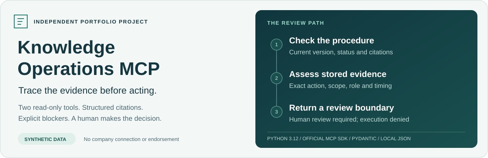
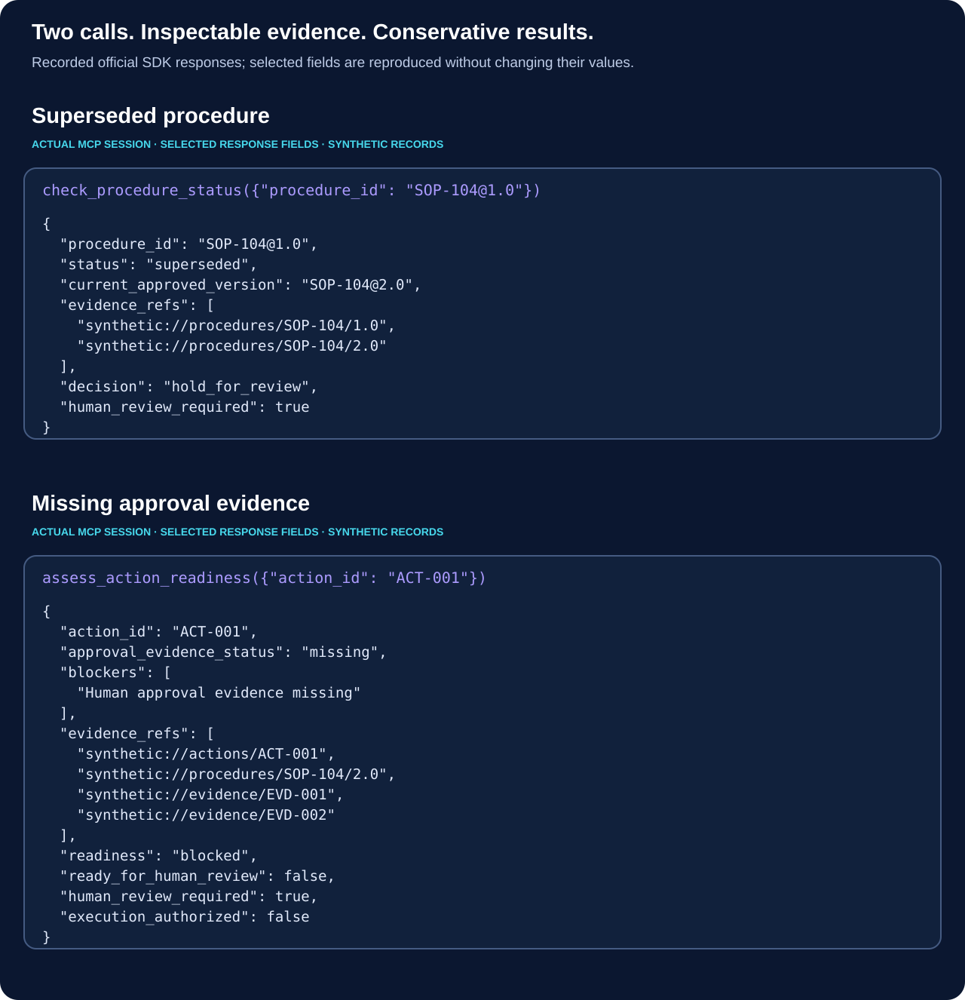
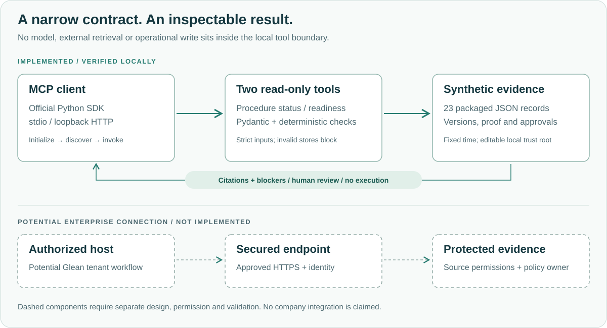

<p align="center">
  
</p>

# Knowledge Operations MCP

**Check a procedure's status. Assess the evidence for a human review.**

A small Python MCP server that turns a dated synthetic evidence snapshot into structured procedure checks, action blockers and traceable citations. Both tools are read-only. Every readiness result requires human review and denies operational execution.

<p>
  <a href="docs/verification.md"></a>
  <a href="docs/verification.md"></a>
  <a href="docs/verification.md"></a>
  <a href=".github/workflows/test.yml"></a>
</p>

[Demonstrations](#two-demonstrations) · [Quick start](#quick-start) · [Architecture](#architecture) · [Reliability](#reliability-and-safety) · [Evidence](#verification-evidence) · [Documentation](#documentation)

> **Independent portfolio demonstration.** All 23 records are synthetic. This project is not affiliated with or endorsed by Stellix or Glean. No company connection, enterprise authentication, deployment or workplace benefit is claimed. Public release has been authorized following provenance confirmation. Hosted verification is pending the initial push; badges currently describe recorded local checks.

## Why this example

Finding a document leaves practical questions: Is this the current version? Does the approval cover this exact action? Is supporting evidence missing or contradictory?

This project makes those checks explicit in a deliberately small example. A caller's `approval_received=true` is not evidence: the server looks up stored records, checks their context, and returns citations and blockers. It does not decide whether real work may proceed.

## Two demonstrations



### 1. Find the current approved procedure

Call `check_procedure_status` with:

```json
{"procedure_id": "SOP-104@1.0"}
```

The result identifies version 1.0 as **superseded**, points to `SOP-104@2.0`, and returns synthetic citations for both records. This is a version check against the packaged snapshot, not live industrial guidance.

### 2. Identify missing approval evidence

Call `assess_action_readiness` with:

```json
{"action_id": "ACT-001"}
```

The result is **blocked** because stored human approval evidence is missing. It keeps `ready_for_human_review=false`, `human_review_required=true` and `execution_authorized=false`.

The same demonstration runs a positive control, `ACT-002`, whose evidence is complete for human review, and rejects an extra caller-supplied approval argument. Even the positive control never authorizes execution. [Complete real protocol transcript](evidence/demo-stdio.json) · [Demonstration guide](docs/demo.md).

## Quick start

Requires [uv](https://docs.astral.sh/uv/) and Python 3.12. Run these commands from the extracted project directory. Internet access is required for the first dependency installation; no model, paid API or company account is needed.

```bash
uv sync --locked --extra dev
uv run --no-sync pytest -q
uv run --no-sync knowledge-ops-demo
```

The demo starts its own stdio server, initializes an official MCP client, discovers both tools, invokes the scenarios, prints JSON and closes the server. Once dependencies are installed, `.venv/bin/knowledge-ops-demo` runs without uv or network access.

For a local HTTP session, use two terminals:

```bash
# Terminal 1
uv run --no-sync knowledge-ops-mcp --port 8765
```

```bash
# Terminal 2
uv run --no-sync knowledge-ops-demo --url http://127.0.0.1:8765/mcp
```

The server binds to loopback. If the port is occupied, select another port in both commands. Stop it with Ctrl-C. Do not expose it through a tunnel or reverse proxy. [Interactive Inspector instructions](docs/demo.md#interactive-inspection).

## Architecture



| Layer | Responsibility |
| --- | --- |
| Official MCP SDK / FastMCP | Tool discovery and calls over stdio or loopback Streamable HTTP |
| Pydantic contracts | Strict input/output schemas and fixture validation |
| Deterministic checks | Procedure version, action scope, supporting proof and stored approval context |
| Packaged JSON | 3 procedure records, 5 actions, 10 evidence records and 5 approvals |
| Structured results | Resolvable synthetic citations, warnings and blockers for human review |

The MCP surface has exactly two tools. Legacy comparison and brief functions remain tested Python helpers. No LLM, vector database, frontend or external source fetching is involved. [Detailed architecture](docs/architecture.md).

## Engineering decisions

- **Bind approval to context.** Match the action, exact procedure version, scope, required role and evidence window.
- **Reject caller assertions.** Extra arguments are rejected; approval must come from the stored snapshot.
- **Fail closed on invalid evidence.** Duplicate JSON fields, duplicate record IDs and inconsistent current versions invalidate the dataset.
- **Make citations resolvable.** Each reference identifies a record in the same snapshot; it is not an external URL to fetch.
- **Keep rehearsal deterministic.** Evaluation uses October 16, 2026 at 12:00 UTC, rather than the current clock.
- **Test the protocol and the package.** Real SDK clients exercise both transports; a non-editable wheel is demonstrated outside the checkout.

## Reliability and safety

Tests cover superseded and missing records, malformed identifiers, wrong-scope or expired approvals, contradictory decisions, corrupted stores, spoofed claims, protocol errors and recovery. See [verification](docs/verification.md).

| Boundary | What this version establishes |
| --- | --- |
| Read-only tools | No operational writes or execution authorization |
| Local transport | HTTP bound to `127.0.0.1`; stdio also supported |
| Evidence consistency | Stored records must match the action and snapshot policy |
| Human decision | Every readiness result requires human review |
| Enterprise identity | **Not implemented**: no SSO, source ACLs, tenant isolation or authenticated HTTP |

The JSON file is editable by its local owner; a consistent forged fixture is not independently authenticated. Read-only annotations and the demo's server-name check are not access controls. [Security and trust model](docs/security.md).

## Potential Glean integration

An authorized Glean host could potentially call a separately secured MCP endpoint and display evidence for a human reviewer. That connection is **proposed**, not implemented or tested in a tenant. Glean's native verification and approval capabilities should be evaluated before deciding whether a custom extension adds value.

A pilot would require a permitted tenant, a workflow and policy owner, supported transport, approved hosting, authentication, permission-scoped evidence access and explicit failure tests. Local protocol success does not prove Glean compatibility. [Integration considerations and official sources](docs/glean-integration.md).

## Future enterprise applications

Possible applications include checking whether an onboarding guide is current, identifying missing review evidence, or assessing whether organizational knowledge is applicable to a new context. These are hypotheses for discovery and co-design. The implemented fixture remains the manufacturing-procedure example; no engagement-knowledge reuse checker or live manufacturing integration is included.

## Known limitations

- The snapshot is small, fictional and frozen in time; it cannot establish current operational readiness.
- Approval identities and roles are synthetic assertions, not verified entitlements.
- No live Glean/Stellix connection, production deployment, TLS, rate limiting or durable audit service exists.
- Exact string matching and conservative conflict handling simplify a real policy system.
- Passing tests measure the implemented local behavior; they do not establish workplace ROI, adoption or production safety.
- Hosted CI is pending the initial push. Local checks do not establish repository settings or hosted behavior.

## Verification evidence

The candidate records **106 passing tests**, including **36 real MCP protocol cases**, stdio/HTTP demonstrations, wheel and source-archive checks. [Verification record](docs/verification.md) lists commands, evidence and scope. [Release audit](docs/public-release-audit.md) records publication gates and limitations.

## Documentation

| Start here | Purpose |
| --- | --- |
| [Demo guide](docs/demo.md) | Two scenarios, positive control, HTTP and Inspector |
| [Architecture](docs/architecture.md) | Contracts, evidence flow and proposed boundary |
| [Security](docs/security.md) | Tested controls, trust assumptions and gaps |
| [Glean considerations](docs/glean-integration.md) | Proposed integration and current official references |
| [Verification](docs/verification.md) | Actual local results and reproduction |
| [Provenance](docs/provenance.md) | Synthetic data, artwork and ownership status |
| [Release audit](docs/public-release-audit.md) | Safety checks and publication gates |
| [Third-party notices](THIRD_PARTY_NOTICES.md) | Dependency license obligations |

```text
src/                 Two tools, typed contracts, checks and synthetic records
tests/               Unchanged domain, protocol and subprocess tests
docs/                Technical documentation and original SVG artwork
evidence/            Fresh local verification and real demo transcripts
.github/workflows/   Pinned verification workflow; no deployment
```

## Rights and attribution

Prepared by Ajanee Igharo with AI-assisted engineering and documentation. This is an independent portfolio project; company names describe a potential context only.

**Copyright © 2026 Ajanee Igharo. All rights reserved.** Available for inspection and portfolio evaluation. No license is granted to reproduce, modify, distribute or commercially reuse the original source code or project materials. [Full rights notice](LICENSE). Third-party components retain their own licenses. [Notices](THIRD_PARTY_NOTICES.md).
