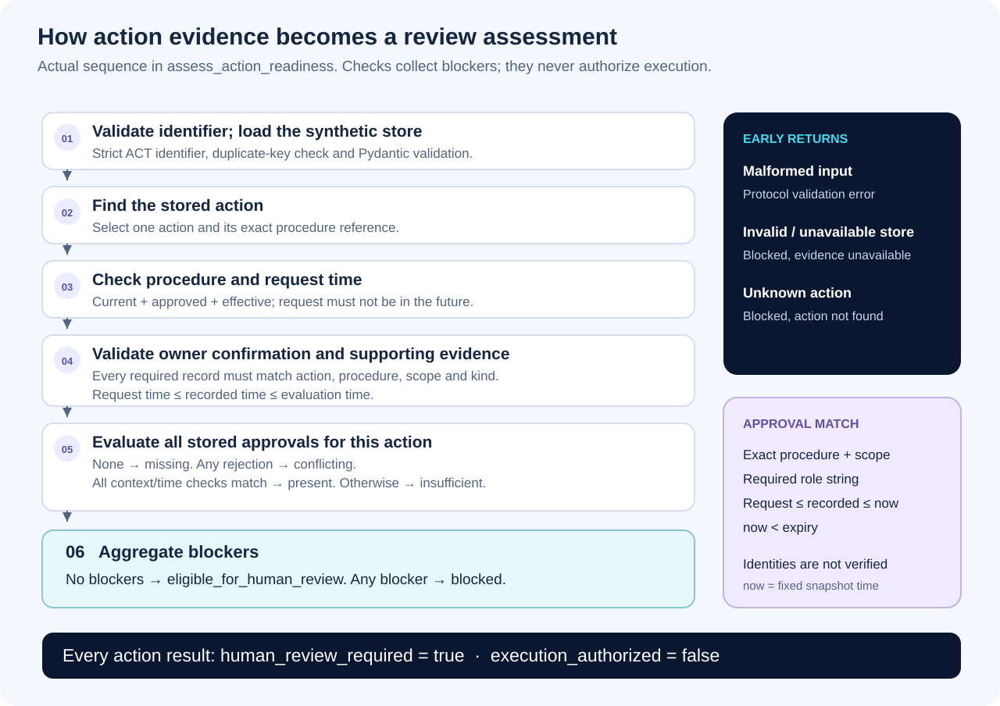
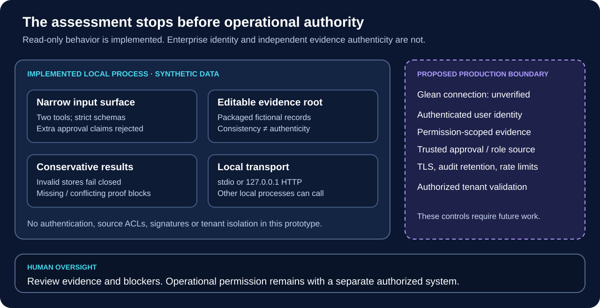

<p align="center">
  
</p>

# Enterprise Knowledge Validation MCP

**Check whether a procedure is current and whether an action has the evidence needed for human review.**

A Python server using the Model Context Protocol (MCP) to turn a dated synthetic knowledge snapshot into structured assessments. Two read-only tools return procedure status, evidence citations and explicit blockers. Every action assessment requires human review and keeps `execution_authorized=false`.

<p>
  <a href="https://github.com/AjaneeI/enterprise-knowledge-validation-mcp/actions/workflows/test.yml"></a>
  <a href="docs/verification.md"></a>
  <a href="docs/verification.md"></a>
  <a href="docs/verification.md"></a>
</p>

[Problem](#the-problem) · [Tools](#implemented-capabilities) · [Demonstrations](#working-demonstrations) · [Architecture](#architecture) · [Validation](#deterministic-validation) · [Trust](#security-and-governance) · [Run locally](#run-locally) · [Documentation](#documentation)

> **Independent portfolio project.** All 23 records are fictional. There is no live Glean or Stellix connection, organizational endorsement, enterprise authentication or operational deployment. The implemented example checks manufacturing-procedure records; broader knowledge reuse and employee adoption are proposed applications.

## The problem

Finding a document leaves questions that search alone may not answer: Is this the effective version? Does the approval cover this exact action and scope? Which supporting record is missing?

This project makes a small set of those questions testable. A caller cannot establish approval by sending `approval_received=true`. The server checks stored evidence, returns the records behind its assessment and keeps missing evidence visible.

The business hypothesis is that explicit evidence checks could make knowledge easier to review before reuse. That hypothesis has not been tested with employees or customer workflows. This repository demonstrates the underlying mechanics on a deliberately small, frozen dataset.

## Implemented capabilities

| MCP tool | Input | Verified behavior |
| --- | --- | --- |
| `check_procedure_status` | `procedure_id`, such as `SOP-104@1.0` | Reports version status, current approved replacement if available, warnings and synthetic citations |
| `assess_action_readiness` | `action_id`, such as `ACT-001` | Checks the procedure, owner/supporting evidence and stored approvals; returns blockers or eligibility for human review |

Each MCP call accepts one identifier. Extra arguments are rejected. Legacy version-comparison and review-brief functions remain tested Python helpers; they are not additional MCP tools.

The dataset contains 3 procedure versions, 5 actions, 10 owner/supporting evidence records and 5 approvals. Evaluation uses **October 16, 2026 at 12:00 UTC**, not the current clock. No LLM, vector database, arbitrary URL fetching or standalone graphical interface is involved.

## Working demonstrations

The gallery reproduces selected JSON fields from an **actual official-SDK stdio session**. These are rendered tool-response captures, not screenshots of a separate application. Values are unchanged; the complete [stdio transcript](evidence/demo-stdio.json), [HTTP transcript](evidence/demo-http.json) and [capture provenance](evidence/visual-capture-provenance.json) remain inspectable.


[Individual procedure capture](docs/assets/demo-procedure.svg) · [Individual readiness capture](docs/assets/demo-readiness.svg)

### A. Superseded procedure and replacement evidence

```json
{"procedure_id": "SOP-104@1.0"}
```

`check_procedure_status` reports `superseded`, identifies `SOP-104@2.0` as the current approved version and cites both records. Its decision is `hold_for_review`. A current replacement does not make the old version eligible.

### B. Missing approval blocks readiness

```json
{"action_id": "ACT-001"}
```

`assess_action_readiness` finds the action and its supporting records, but no stored approval. It returns `approval_evidence_status="missing"`, `readiness="blocked"` and the blocker `Human approval evidence missing`.

The same session includes a positive control: `ACT-002` has complete evidence for human review. It still returns `human_review_required=true` and `execution_authorized=false`. An extra caller-supplied approval argument is rejected. [Walkthrough and reproduction](docs/demo.md).

## Architecture


FastMCP handles discovery and tool calls over stdio or loopback Streamable HTTP. Pydantic defines strict contracts. The deterministic logic loads one validated snapshot per assessment, evaluates its records and returns typed JSON.

The packaged JSON file is the evidence source and local trust root. Citations such as `synthetic://approvals/APR-002` identify records in that snapshot; the server does not fetch these as URLs. Packaging the fixture under `src/data/` lets the installed wheel work outside the checkout. [Architecture details](docs/architecture.md).

## Deterministic validation



The action assessment checks the procedure's status and effective date, the action request time, owner confirmation, required supporting records and all approvals stored for the action. Evidence must match its action, exact procedure version, scope, kind and time window. Approval checks compare the required role string and reject expired or misbound records.

Approval status follows a specific order: no records means `missing`; any rejection means `conflicting`; all records matching context and time means `present`; otherwise it is `insufficient`. Procedure, request-time, evidence and approval failures accumulate blockers. Zero blockers means **eligible for human review**.

An invalid dataset or an unknown action returns early with a blocked result. Malformed MCP input produces a protocol validation error. Stored names and roles are not independently authenticated. [Exact rules, time inequalities and code map](docs/validation-rules.md).

## Engineering decisions and tradeoffs

| Decision | Reason | Cost or limitation |
| --- | --- | --- |
| Two narrow tools | Keep discovery and inputs easy to inspect | This is a small example, not a general policy engine |
| Stored evidence rather than caller assertions | Make the assessment traceable to specific records | A local fixture editor can still forge a consistent dataset |
| Validate the whole store | Reject duplicate fields, ambiguous records and contradictory current versions | One invalid record makes the dataset unavailable |
| Conservative approval conflicts | Avoid silently selecting a convenient approval | No override hierarchy or approval-reversal workflow |
| Frozen evaluation time | Make scenarios and boundary tests repeatable | Results do not establish readiness today |
| Explicit human-review fields | Preserve the boundary between assessment and authority | A future host must display and respect those fields |
| Real protocol and package tests | Check both contracts and distribution behavior | Local success does not establish enterprise compatibility |

## Reliability and verification

The preserved suite contains **106 tests, including 36 real MCP protocol cases**. Official SDK clients exercise stdio and Streamable HTTP, discovery, typed responses, invalid arguments, spoofed approval claims, corrupted evidence and recovery. Other tests cover duplicate keys/IDs, contradictory procedure records, timing boundaries, approval scope and package startup.

[GitHub Actions](https://github.com/AjaneeI/enterprise-knowledge-validation-mcp/actions/workflows/test.yml) runs the complete suite, an actual stdio demonstration, package build and an installed-wheel demonstration outside the checkout. The [first public run](https://github.com/AjaneeI/enterprise-knowledge-validation-mcp/actions/runs/38956463760) passed on the clean initial snapshot. The badge above tracks `main`; [verification documentation](docs/verification.md) separates hosted checks from additional recorded local checks.

The build backend is pinned to **setuptools 83.0.0**. The recorded advisory regression fails with the affected 82.0.1 backend and passes with 83.0.0. The dependency review found no advisory matches in its queried scope; this is a dated result, not a continuing security guarantee. [Dependency evidence](evidence/dependency-advisories.json) · [Build regression](evidence/build-advisory-regression.json).

## Security and governance



The tools perform no operational writes. Strict identifiers prevent callers from choosing arbitrary files, and cited records are resolved locally. Invalid or unavailable data produces conservative results. The HTTP server binds to `127.0.0.1`; stdio needs no network listener.

The fixture remains editable, and loopback is not authentication. There is no SSO, role-entitlement verification, source ACL enforcement, tenant isolation, TLS, rate limiting or protected audit service. Other local processes can call the HTTP endpoint. Read-only annotations describe behavior; they do not grant access control.

Use fictional data for this demonstration. Do not expose it through a tunnel or public reverse proxy. Before a real pilot, a policy owner would need to establish trusted evidence, identity, least-privilege access, retention and failure behavior. [Security model](docs/security.md) · [Reporting guidance](SECURITY.md).

## Potential Glean integration

**Proposed, not connected or tenant-tested.** An authorized Glean host could potentially call a separately secured MCP endpoint and present citations and blockers to a reviewer. The diagram keeps that future boundary separate from the implemented local process.

Glean already provides native knowledge-verification and action-confirmation capabilities. A pilot should compare those options before deciding whether custom cross-record rules add value. Hosting, supported transport, authentication, permission-scoped evidence, tool availability and faithful display of blockers all require an authorized tenant test. [Integration considerations and official sources](docs/glean-integration.md).

## Future contextual knowledge reuse

A possible next application is assessing whether prior engagement knowledge fits a new context. Facility/system compatibility, revision history, permitted reuse and cross-engagement approvals could matter. These are **discovery questions**, not implemented checks or a diagnosis of Stellix's current workflow.

The current exact-scope and procedure-version comparisons are simpler than contextual applicability. No contextual reuse engine, real industrial system adapter or client-data connection is included. [Future applications and boundaries](docs/future-applications.md).

## Employee adoption and workflow implementation

A future pilot would start with a workflow owner and a recurring review task, then compare the proposed check with the current process and Glean-native alternatives. An opt-in cohort should see where evidence comes from, what a blocker means and who resolves it. The tool's usefulness depends on that handoff as much as on its schema.

Candidate measures include correct task completion, missed blockers, review effort, repeat use and reasons for abandoning the workflow. Baselines, consent, retention and success criteria must be agreed before collecting data. There are **no measured adoption or organizational ROI results** in this repository. [Pilot considerations](docs/future-applications.md#proposed-adoption-pilot).

## Run locally

Requires [uv](https://docs.astral.sh/uv/) and Python 3.12. The first install needs internet access. No model account, paid API or company credentials are required.

```bash
git clone https://github.com/AjaneeI/enterprise-knowledge-validation-mcp.git
cd enterprise-knowledge-validation-mcp
uv sync --locked --extra dev
uv run --no-sync pytest -q
uv run --no-sync knowledge-ops-demo
```

The demo launches its own stdio server, discovers both tools, invokes the scenarios and prints JSON. After installation, `.venv/bin/knowledge-ops-demo` runs without uv or external services. The existing package/command names are retained to preserve the verified implementation.

For HTTP, start the loopback server in one terminal:

```bash
uv run --no-sync knowledge-ops-mcp --port 8765
```

In another terminal:

```bash
uv run --no-sync knowledge-ops-demo --url http://127.0.0.1:8765/mcp
```

Choose another port in both commands if needed; Ctrl-C stops the server. [Demo and optional Inspector guide](docs/demo.md).

Build the package or inspect the protocol cases:

```bash
uv build
uv run --no-sync pytest tests/test_protocol.py -q
```

## Documentation

| Document | What to inspect |
| --- | --- |
| [Demo guide](docs/demo.md) | Two scenarios, positive control, HTTP and optional Inspector |
| [Architecture](docs/architecture.md) | Contracts, evidence flow and the proposed integration boundary |
| [Validation rules](docs/validation-rules.md) | Exact evidence/approval rules and early returns |
| [Security](docs/security.md) | Tested controls, local trust assumptions and enterprise gaps |
| [Glean considerations](docs/glean-integration.md) | Proposed connection requirements and official references |
| [Future applications](docs/future-applications.md) | Contextual reuse, workflow ownership and an adoption pilot |
| [Verification](docs/verification.md) | Reproduction, actual test/package results and scope |
| [Visual evidence](docs/visual-evidence.md) | Capture provenance, diagram mapping and asset inventory |
| [Release audit](docs/public-release-audit.md) | Sanitization, rights and publication checks |
| [Provenance](docs/provenance.md) | Independent AI-assisted origin, synthetic records and artwork |
| [Third-party notices](THIRD_PARTY_NOTICES.md) | Upstream dependency obligations |

```text
src/                 Two tools, contracts, checks and synthetic records
tests/               Preserved domain, protocol and subprocess tests
docs/                Technical case study and original project artwork
evidence/            Real SDK transcripts and dated verification records
.github/workflows/   Pinned test/build workflow; no deployment
```

## Provenance and rights

Ajanee Igharo prepared this independent project with ChatGPT/Codex-assisted code, testing, documentation and visual design. The maintainer confirmed the prototype's independent origin; the narrow provenance review identified no specific unresolved redistribution restriction. This does not establish legal exclusivity or imply company sponsorship. [Provenance assessment](docs/provenance.md).

**Copyright © 2026 Ajanee Igharo. All rights reserved.**

This repository is publicly available for inspection and portfolio evaluation. No license is granted to reproduce, modify, distribute, or commercially reuse the original source code or project materials. The notice does not claim exclusive rights over third-party or noncopyrightable elements. [Full rights notice](LICENSE). Dependencies retain their applicable [third-party terms](THIRD_PARTY_NOTICES.md).
