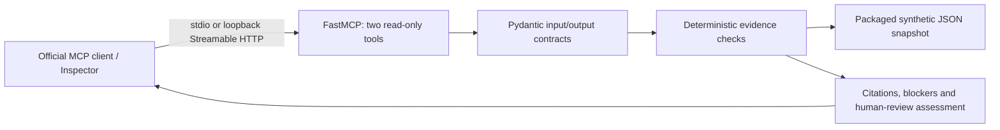
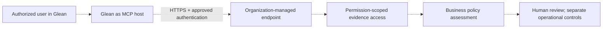

# Architecture

## Implemented and tested locally

The two tools are `check_procedure_status(procedure_id)` and `assess_action_readiness(action_id)`. FastMCP performs protocol handling and typed schema generation. The application rejects extra arguments, validates fixture data and derives decisions from one loaded snapshot per assessment. No model, retrieval index or inference service is involved.

The fixture retains three original procedure versions and adds five actions, ten owner/supporting evidence records and five approval records. The evaluation timestamp is fixed. Procedures are identified by family plus version; `SOP-104@1.0` and `SOP-104@2.0` are different records. Citations use `synthetic://procedures/SOP-104/2.0`, `synthetic://actions/ACT-002`, `synthetic://evidence/EVD-003` and `synthetic://approvals/APR-002`.

Approval records bind action, exact procedure, scope, approver identity/role and time window. An approval is insufficient if its context or timing differs. Any rejection is conservatively conflicting. Owner and supporting evidence are checked independently. Eligible means the evidence is complete for a human review at the snapshot time. Execution remains unauthorized.

HTTP defaults to `http://127.0.0.1:8765/mcp`. Stdio launches as a subprocess and needs no open port. Tests use fresh loopback ports and verify server identity before invoking tools. Package data is inside `src/data` so a wheel can run away from the checkout.

## Potential integration, designed only

Every component and connection in the second diagram is proposed. The local prototype has no authentication or real source-permission enforcement. [Integration requirements](glean-integration.md) and [security boundaries](security.md) explain what must be validated before a pilot. The inverse architecture, Glean exposing its own MCP server to another host, is a different connection direction.
